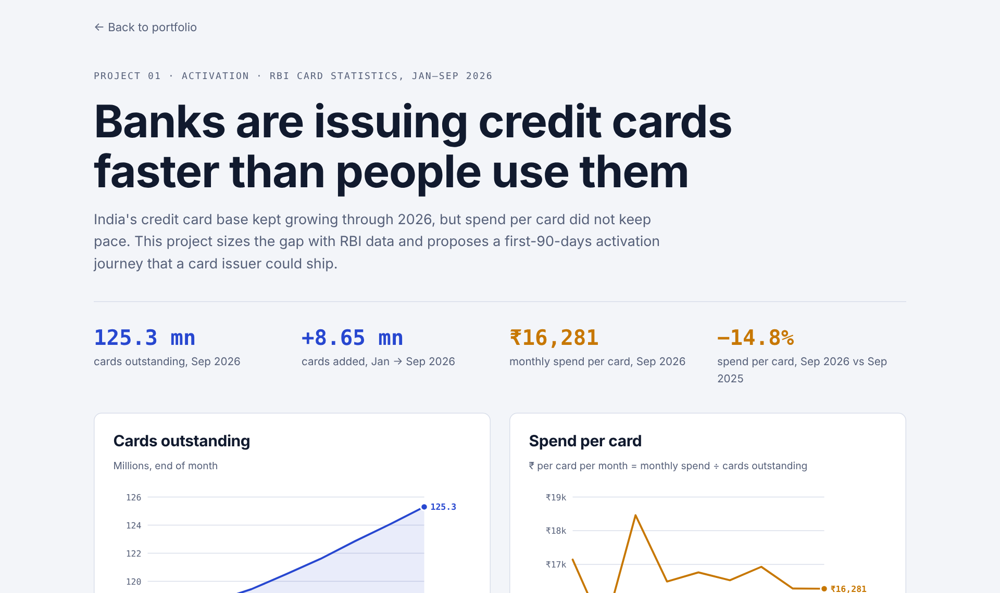

# Card Pulse

**Banks in India are issuing credit cards faster than people use them.** This project sizes the gap with RBI data and designs a first-90-days activation journey a card issuer could ship.

[**Live dashboard**](https://abhinavspambox.github.io/projects/card-pulse/) · [Portfolio](https://abhinavspambox.github.io/) · [Dataset](https://github.com/abhinavspambox/india-payments-data)



## The signal

| Measure | Value |
| --- | --- |
| Credit cards outstanding, Sep 2026 | 125.3 million |
| Cards added, Jan → Sep 2026 | +8.65 million (+7.4%) |
| Monthly spend per card, Jan → Sep 2026 | ₹17,145 → ₹16,281 (−5.0%) |
| Spend per card, Sep 2026 vs Sep 2025 | −14.8% |

## The product

A 90-day activation journey for new cardholders:

1. **First-spend nudge** within 7 days of delivery, tied to cashback on the first three spends.
2. **Pick-your-category welcome offer** so the card fits a habit the customer already has.
3. **Small-ticket rail**: one-tap UPI linking where the issuer offers a RuPay variant.
4. **Plain-language first bill** with two reminders before the due date.

**North star:** spend per card in the first 90 days. **Guardrails:** 90-day delinquency, complaints per 10,000 new cards, reward cost per activated card.

## Discovery plan

The data shows the gap, not the reason. Next step: 10 interviews with people who got a card in the last year and rarely use it. The hypotheses and interview guide are on the [dashboard](https://abhinavspambox.github.io/projects/card-pulse/#discovery). *Status: not yet run.*

## Run it

```bash
python analysis.py        # Python 3, standard library only
```

| File | Contents |
| --- | --- |
| `data.csv` | Monthly cards outstanding and spend, Jan–Sep 2026, with source links |
| `issuers_apr2026.csv` | HDFC Bank, SBI Card and ICICI Bank, April 2026 |
| `analysis.py` | Spend per card, index and issuer comparison |
| `index.html` | The dashboard (open in a browser) |

---

Part of [Abhinav Kumar Tarkar's product portfolio](https://abhinavspambox.github.io/). Figures are compiled from public RBI and NPCI releases as reported in the press; every row links to its source. Product proposals are my own and do not reflect any employer's plans.
